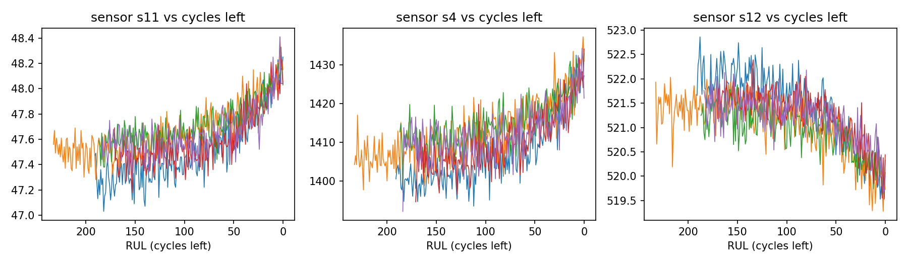

# When will this jet engine fail?

Predicts the remaining useful life (RUL) of jet engines, in flight cycles, from 21 sensors, using NASA's C-MAPSS turbofan degradation data.

**Status:** Stage 1 complete (data profiled, baselines on NASA's official test engines). Feature engineering and deep learning are next.

## Why
Airlines and engine lessors plan maintenance, spare parts and aircraft availability around remaining-life estimates. Too early wastes money; too late grounds the aircraft, so late errors cost more than early ones.

## Baselines (FD001, 100 official test engines)
| Model | RMSE (cycles) | NASA score (lower is better) |
|---|---|---|
| Predict the average | 43.1 | 33,629 |
| Linear regression | 21.9 | 1,318 |
| Random forest | 18.3 | 899 |

55% of the random forest's predictions are late (the costly side), so the next goal is reducing late errors, not just average error. Reproduce with `src/01b_baselines_nasa.py`.



## Data
NASA C-MAPSS (Saxena et al., 2008), official NASA download, US government public data. All four subsets (FD001 to FD004) and the original paper are in `data/raw/`. `train_FD004.txt` is stored gzipped (`train_FD004.txt.gz`) to stay under upload limits; pandas reads it directly with `pd.read_csv(..., sep=r'\s+', header=None)`. See `DATA_SOURCES.md`.

## Plan
| Stage | Work | Status |
|---|---|---|
| 1 | Build RUL target, drop constant sensors, plot drift; baselines | Done |
| 2 | Rolling and trend features, grouped cross-validation by engine, tuned trees | Next |
| 3 | PyTorch neural network; sequence model (stretch) | |
| 4 | Harder subsets FD002 to FD004 | |
| 5 | LLM maintenance alerts checked for errors; cost-based evaluation | |

## Structure
```
src/01_load_and_profile.py   target, constant sensors, drift plot
src/01b_baselines_nasa.py    baselines on official test engines
data/raw/                    NASA C-MAPSS files
reports/                     profile, figures
docs/                        project brief (Word)
```

## Run
Python 3.10+, `pip install -r requirements.txt`, then run the scripts in `src/` in order.

## Author
Kerem Aviskan, BSc Economics, University of Warwick. Built with AI assistance, declared in my coursework.
